# Sistema de diseño de ApexApp

Referencia para quien implemente pantallas. Dirección de arte: skill `design-taste-compose`.

## Stitch

Proyecto `3824318768696066700` ("ApexApp"), design system `assets/8284090323799835001` ("Apex"):
oscuro primero, acento naranja señal, Sora (titulares/hora) + Inter (resto), radio 4 dp.
`design/DESIGN.md` resume el sistema; capturas en `design/screens/` y HTML en `design/screens/html/`.

### Pantallas de referencia

| Pantalla | Oscuro | Claro |
|---|---|---|
| Lista de alarmas | `lista-alarmas` | `lista-alarmas-claro` |
| Editor | `editor` | `editor-claro` |
| Alarma sonando | `alarma-sonando` | `alarma-sonando-claro` |
| Reto matemático | `reto-matematico` | `reto-matematico-claro` |
| Estadísticas | `estadisticas` | `estadisticas-claro` |
| Ajustes | `ajustes` | `ajustes-claro` |
| Compartir | `compartir` | `compartir-claro` |

Cada nombre existe como `.png` (780 px de ancho) y como `html/<nombre>.html`. Los ids de Stitch están en `DESIGN.md`.

### La app frente a los diseños

Capturas de la app real (oscuro y claro, 360 dp) en `design/screens/app/`. Alarma sonando, reto matemático,
estadísticas, ajustes y compartir se renderizan con el contenido sin estado sobre datos de ejemplo; lista y editor
son capturas del emulador con alarmas de prueba.

| Pantalla | Oscuro | Claro |
|---|---|---|
| Lista de alarmas | 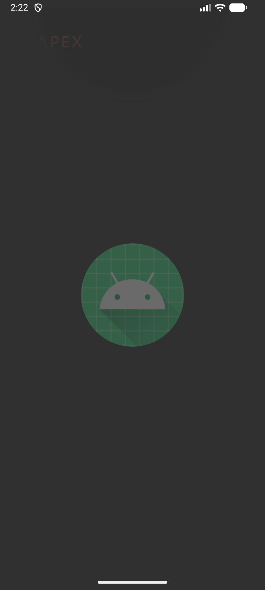 | 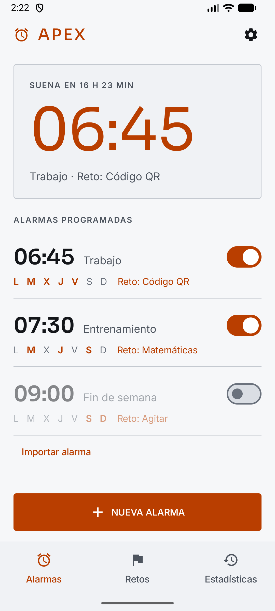 |
| Editor | 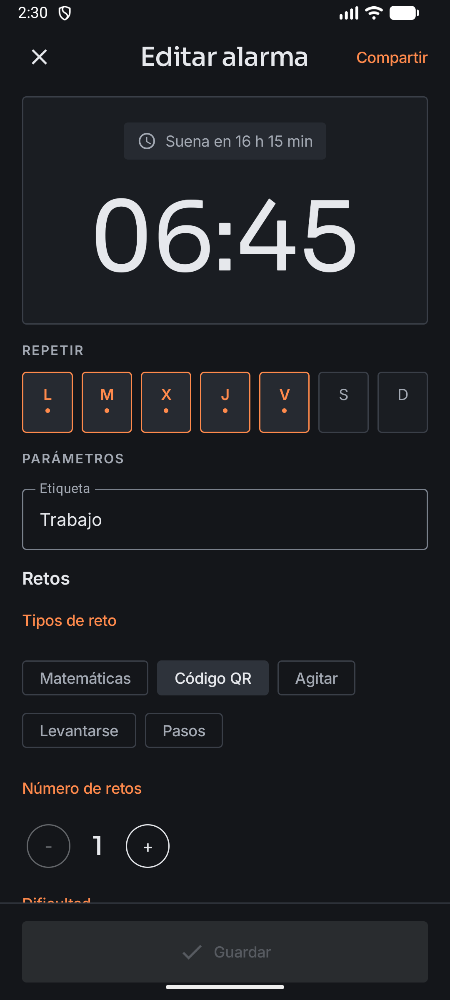 | 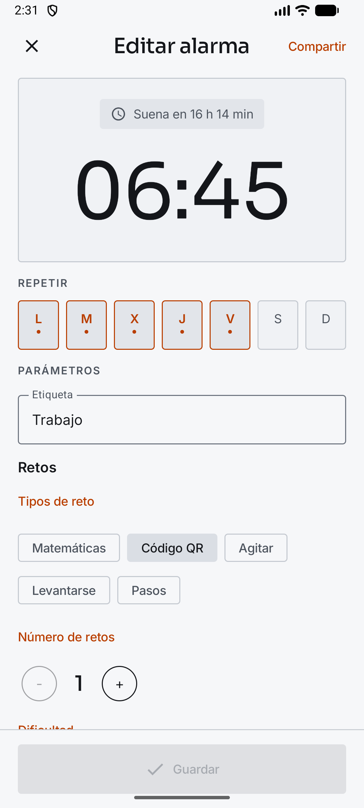 |
| Alarma sonando | 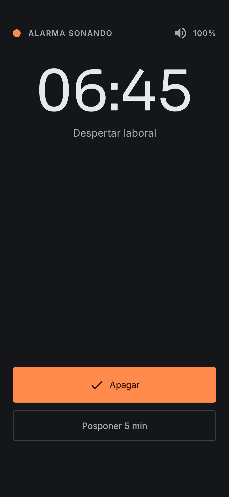 | 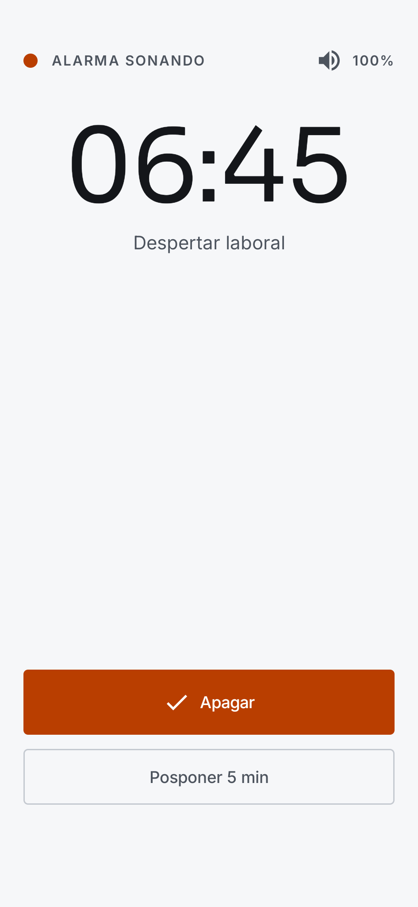 |
| Reto matemático | 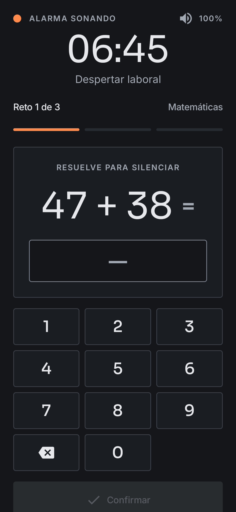 | 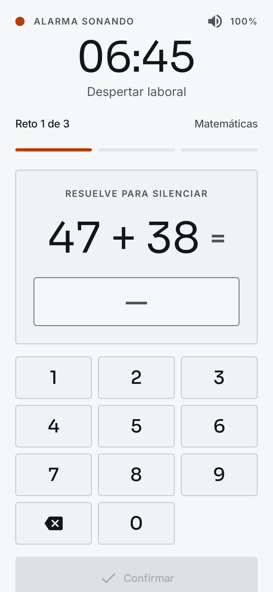 |
| Estadísticas | 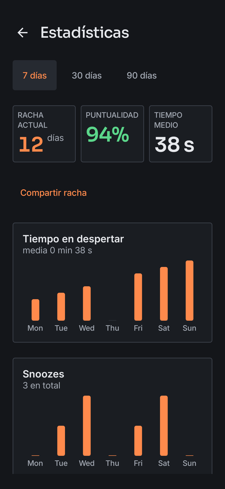 | 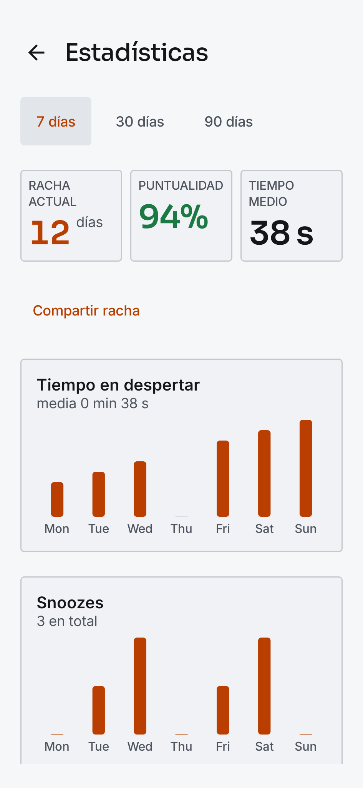 |
| Ajustes | 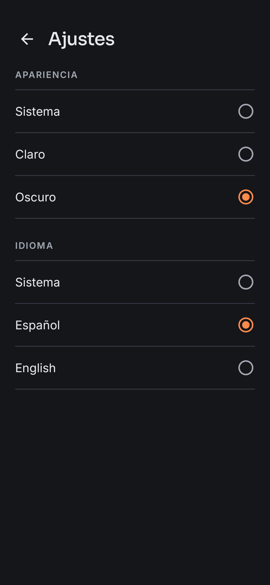 | 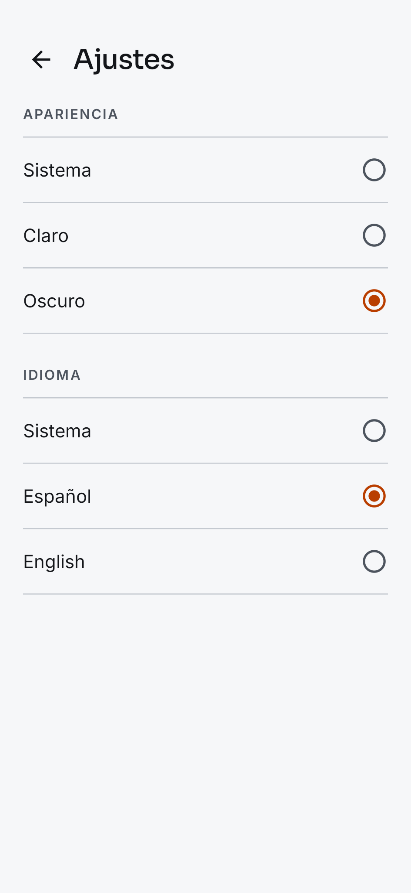 |
| Compartir | 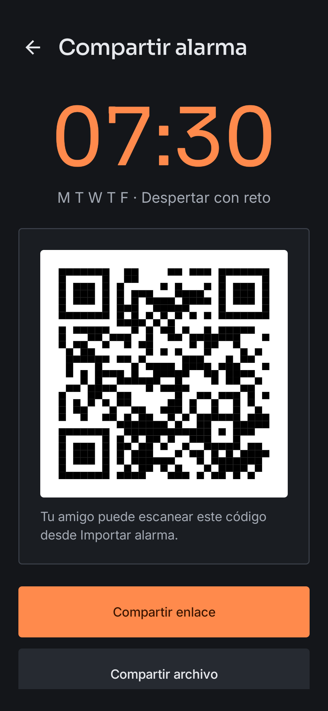 | 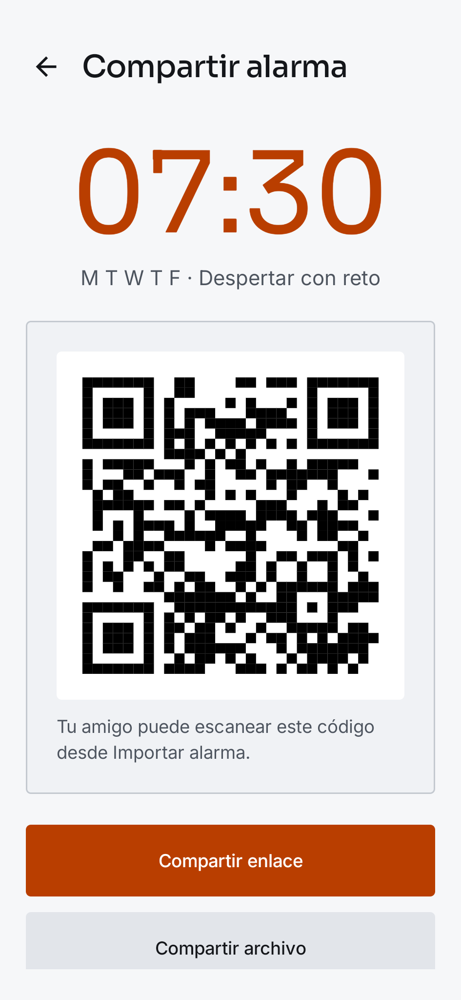 |

Diferencias asumidas respecto a Stitch: la hora usa peso normal (decisión del tema, no el negro de Stitch); no hay
numeración "01 //" ni tipografía mono; el editor no muestra AM/PM ni papelera; estadísticas no tiene "sesiones
recientes" ni resumen de sueño (no hay datos en el estado); en claro la tarjeta de próxima alarma y la de alarma
sonando usan la misma composición que en oscuro.

### Selector de hora (ruedas)

El selector de M3 con dial circular se sustituyó por `TimeWheelPicker` (`ui/components`): dos ruedas verticales con snap,
fila central resaltada en acento y vecinas atenuadas, AM/PM en 12 h y entrada numérica al tocar la hora central.
Capturas de la app (editor con el selector, 12 h del emulador): `screens/app/editor-selector-hora-claro.png` y
`screens/app/editor-selector-hora-oscuro.png`.

Stitch: se intentó generar la pantalla (oscuro y claro, `editor-selector-hora*`) con el design system Apex y las dos
generaciones acabaron en timeout sin devolver id; `get_project` no lista pantallas, así que no hay PNG/HTML de Stitch
de este selector. El diseño se resolvió directamente en Compose siguiendo `DESIGN.md`.

### Limitaciones de la API de Stitch

- `list_screens` devuelve vacío y `get_project` no trae `screenInstances`: un id solo se conoce si la llamada de
  generación lo devuelve. Dos generaciones del reto matemático (oscuro y claro) y una `generate_variants` acabaron en
  timeout sin id, así que no se pudieron recuperar; se regeneraron con prompts más cortos.
- `generate_variants` no sirvió para las versiones en claro (timeout sin id). Las 7 pantallas en claro son pantallas
  nuevas generadas con `generate_screen_from_text` y el design system Apex, indicando el modo claro y `#B93E00` en el prompt.
  El tema guardado del proyecto sigue siendo oscuro (`colorMode: DARK`); el claro vive solo en esas pantallas.
- `download_file` devuelve los bytes en línea; las capturas se bajaron de la `downloadUrl` de `get_screen` (`lh3...=w780`).
- Stitch añade por su cuenta cosas que el sistema descarta: tarjetas con borde en las listas claras, barra inferior
  Alarmas/Retos/Historial y numeración. Son guía de composición, no especificación (ver la app real para lo vigente).

### Accesibilidad (verificado)

Cálculo WCAG 2.x sobre `ui/theme/Color.kt` (luminancia relativa; texto >= 4.5:1, componentes >= 3:1):

- **Oscuro**: todos los pares de texto cumplen (mínimo 5.37:1, `onSurfaceVariant` sobre `surfaceContainerHighest`;
  `primary` sobre `surface` 7.76:1; `onPrimary` sobre `primary` 6.95:1; `error` 6.53:1; éxito 9.86:1). Componentes:
  `primary` 7.76, `outline` 4.61 (4.06 sobre `surfaceContainer`), éxito 9.86, error 6.53.
- **Claro**: todos los pares de texto cumplen (mínimo 4.72:1, `primary` sobre `surfaceContainer`;
  `primary` sobre `surface` 5.22:1; `onPrimary` sobre `primary` 5.60:1; `error` 6.03:1; éxito 5.01:1). Componentes:
  `primary` 5.22, `outline` 4.53 (4.09 sobre `surfaceContainer`), éxito 5.01, error 6.03.
- Excepción conocida: `outlineVariant` (1.71:1 oscuro, 1.55:1 claro) es solo separador decorativo, exento por WCAG 1.4.11;
  la app no lo usa fuera del tema. Un borde que delimite un campo debe usar `outline`.
- Colores de las pantallas de Stitch en claro (`#B93E00`/`#F8F9FA` 5.31:1, blanco/`#B93E00` 5.60:1, éxito `#1B7F4B` 4.76:1,
  fallo `#B3261E` 6.20:1) y en oscuro (`#FF8A4C`/`#0C0E12` 8.27:1, `#FF6B6B` 6.96:1) también cumplen.

### Fuente 1.3 sobre los diseños

Revisión de las capturas (780 px = 360 dp a 2.17x) con texto un 30 % mayor:

- Alarma sonando (claro): el botón "Resolver reto para apagar" ya se parte en dos líneas a 1.0; a 1.3 hay que
  dejar que el botón crezca en alto, nunca fijar su altura.
- Reto matemático (claro): botón y teclado ocupan casi todo el alto; a 1.3 el contenido debe hacer scroll por encima del teclado.
- Editor: las siete casillas de días son de ancho fijo; a 1.3 el rótulo de dos letras ("L", "M"...) sigue cabiendo,
  pero la fila no admite etiquetas más largas. El título "Reto para apagar" + "Imposible posponer" compite por línea: debe poder envolver.
- Lista, estadísticas, ajustes y compartir: filas con texto que envuelve; sin cortes previsibles.

La app se verificó en emulador con fuente 1.3 (change `design-system-stitch`, 7.1) y cada `@Preview` de pantalla incluye `fontScale` 1.3.

## Tema (`ui/theme`)

- Color: `DarkColorScheme` / `LightColorScheme` en `Color.kt`. Un acento (`primary`); éxito = `tertiary`,
  fallo = `error`. Niveles con `surfaceContainer*`, sin sombras. `dynamicColor = false` por defecto.
- Tipografía: `Type.kt`, fuentes variables en `res/font` (Sora, Inter; OFL). La hora usa `displayLarge`/`displayMedium`
  con cifras tabulares.
- Forma: un solo radio (`Shape.kt`, 4 dp).
- Espaciado: `ApexTheme.spacing` (`xs`…`xxxl`, `screen`).
- Nunca `Color(0xFF…)`, `sp` ni `dp` de diseño sueltos en pantallas: todo vía `MaterialTheme` / `ApexTheme`.

## Componentes (`ui/components`)

`PrimaryAction`, `TimeDisplay`, `SectionHeader`, `EmptyState`. Reutilízalos antes de crear variantes.
Listas como filas, no tarjetas.

## Ajustes (`ui/settings`)

Añade tu sección dentro de la columna de `SettingsContent` con `SectionHeader` + contenido.

## Strings

- Todo texto visible en `res/values/strings.xml` (español, base) y `res/values-en/strings.xml`.
- Prefijo de clave por área: `alarm_`, `challenge_`, `stats_`, `share_`, `settings_`…
- Lint `MissingTranslation` y `HardcodedText` son error.
- Los tests de UI obtienen los textos de recursos (`targetContext.getString`), no literales.

## Alarma normal / con retos

La sección «Retos» del editor abre con un selector «Normal» / «Con retos» (`SegmentedButton`). Normal = sin tipos de reto: se ocultan el resto de controles y se muestra «Se apaga con un toque.». El modo es Normal si no hay tipos ni se ha pasado a «Con retos» (`ChallengeConfig.challengesEnabled`); al pasar a «Con retos» no se preselecciona ningún tipo y, mientras no haya al menos uno, se muestra «Elige al menos un tipo de reto para guardar la alarma.» y la alarma no se puede guardar. Capturas: `screens/app/editor-normal-claro.png`, `editor-normal-oscuro.png`, `editor-con-retos-claro.png` y `editor-con-retos-oscuro.png`.

## Retos nuevos y mejoras de alarma

Diseños hechos fuera de Stitch, en HTML con los tokens reales del tema. `screens/html/apex-tokens.css` copia los
esquemas de `Color.kt`, la tipografía de `Type.kt`, el radio y el espaciado. Las fuentes salen de `res/font`.
`screens/html/apex-ui.css` replica los componentes. Cada pantalla mide 360 dp de ancho (1 px = 1 dp); la versión
`-claro` es el mismo HTML con `<html data-theme="light">`. Abre cualquiera directamente en el navegador.

> **Pendiente:** estas pantallas solo existen como HTML; aún no hay PNG en `screens/`. La UI se implementa a partir de
> los HTML y de esta especificación.
>
> **Supuestos por confirmar con el código real:** el margen de 2 min para pulsar «Estoy despierto» antes de que la
> alarma vuelva a sonar, y las cifras de ejemplo de las líneas de nivel en «Ajustes de cada reto» (5 formas, 0,8 s,
> 8 × 8, 5 pasos, ritmo medio).

| Pantalla | Oscuro | Claro |
|---|---|---|
| Secuencia de formas · responder | `reto-secuencia-formas` | `reto-secuencia-formas-claro` |
| Secuencia de formas · observar | `reto-secuencia-formas-observar` | `reto-secuencia-formas-observar-claro` |
| Laberinto · trazo en curso (8 × 8) | `reto-laberinto` | `reto-laberinto-claro` |
| Laberinto · muro tocado | `reto-laberinto-error` | `reto-laberinto-error-claro` |
| Laberinto · 12 × 12 | `reto-laberinto-grande` | `reto-laberinto-grande-claro` |
| Memoria de cuadrícula · responder (3 × 3) | `reto-memoria-cuadricula` | `reto-memoria-cuadricula-claro` |
| Memoria de cuadrícula · observar | `reto-memoria-cuadricula-observar` | `reto-memoria-cuadricula-observar-claro` |
| Memoria de cuadrícula · 5 × 5 | `reto-memoria-cuadricula-grande` | `reto-memoria-cuadricula-grande-claro` |
| Editor · silencio, posponer y verificar | `editor-silencio-posponer-verificar` | `editor-silencio-posponer-verificar-claro` |
| Editor · ajustes de cada reto | `editor-dificultad-retos` | `editor-dificultad-retos-claro` |
| Alarma sonando · sin posposiciones | `alarma-sonando-sin-posposiciones` | `alarma-sonando-sin-posposiciones-claro` |
| Notificación · verificar que estoy despierto | `notificacion-verificar` | `notificacion-verificar-claro` |

### Marco común de los retos

Igual que `RingChallenges`: `RingChallengeHeader` (estado, `TimeDisplay` mediano y etiqueta), luego la sesión con
padding `screen` × `xl` y separación `xl`: «Reto n de N» + tipo (`labelLarge`) y `ProgressSegments` (4 dp, separación
4 dp, hechos en `primary` y pendientes en `surfaceContainerHighest`). Debajo, título del reto (`titleMedium`,
`onSurface`, centrado) y una línea de estado (`bodyMedium`, `onSurfaceVariant`). Al pie, el botón de posponer.

Puntos de avance dentro de un reto: círculos de 8 dp separados 8 dp. Hechos en `onSurface`, el actual en `primary`
y los pendientes en `surfaceContainerHighest`. Son decorativos: el avance se dice también con texto («2 de 5»).

### Secuencia de formas

- Seis formas que se distinguen por la silueta, nunca por el color: círculo, cuadrado, triángulo, rombo, cruz y
  hexágono. Van rellenas de `onSurface` en una rejilla de 48 y cada una tiene nombre accesible.
- **Observar:** escenario de 240 dp (`surfaceContainerLow`, borde `outlineVariant`) con la forma a 128 dp, una cada
  vez. Debajo, «Forma 3 de 5» y los puntos de avance. No se puede tocar nada.
- **Responder:** cinco huecos de 56 dp de alto en una fila. Los rellenos llevan la forma a 28 dp sobre
  `surfaceContainerLow`; el siguiente, borde de 2 dp en `primary`; el resto, borde `outlineVariant` sin relleno.
  «Borrar última» es un `TextButton` en `onSurface` con icono, alineado a la derecha y de 48 dp. Paleta de 3 × 2
  botones de 88 dp de alto (borde `outline`, `surfaceContainerLow`) con la forma a 36 dp y su nombre en
  `bodyMedium` `onSurfaceVariant`.
- Fallo: el mismo patrón que la memoria actual, con el mensaje en `error` y la secuencia otra vez en «observar».

### Laberinto

- Tablero de 296 dp en `surfaceContainerLow`, centrado. Muros de 3 dp en `onSurfaceVariant`; 8 × 8 da casillas de
  37 dp y 12 × 12 de 24,7 dp.
- Inicio: el despertador (disco `primary` con esfera y aguja) en la casilla de arriba a la izquierda. Salida: hueco
  en el borde derecho de la casilla de abajo a la derecha, con una flecha en `tertiary` y la leyenda «Salida».
- Trazo en `primary`, 8 dp, con extremos y uniones redondeados. El dedo se marca con un aro de 2,5 dp y un punto en
  `primary`.
- Es un gesto continuo, no un toque, así que no aplica el mínimo de 48 dp. Para el 12 × 12, tolerad unos 8 dp antes
  de contar un muro como tocado.
- **Muro tocado:** aviso `errorContainer` / `onErrorContainer` con icono, «Has tocado un muro. Vuelve a empezar desde
  la alarma.» El trazo fallido queda punteado en `error` y hay una X en `error` sobre el punto de contacto. Al
  levantar el dedo o al volver a tocar el inicio, el trazo se borra. «Intento N» abajo a la izquierda.

### Memoria de cuadrícula

- Tablero 3 × 3 de 304 dp (casillas de 96 dp), 4 × 4 o 5 × 5 de 320 dp (casillas de 57,6 dp). Separación 8 dp,
  `surfaceContainerLow` con borde `outlineVariant`.
- Casilla iluminada: `primary`, borde incluido. Casilla al tocarla: `secondaryContainer` con borde de 2 dp en
  `onSurface`. Iluminada y tocada se distinguen por luminosidad y borde, no solo por tono.
- **Observar:** «Memoriza la secuencia» + «Paso 3 de 5 · no toques todavía»; casillas desactivadas. **Responder:**
  «Repite la secuencia» + «2 de 5». Cada casilla anuncia «Casilla N» / «Casilla N, iluminada»
  (`challenge_memory_cell*`).

### Ajustes de alarma

- **No sonar mientras resuelvo:** fila con `Switch` en la sección «Mientras resuelves los retos» (solo con «Con
  retos»). Si está activo, debajo y sangrado (filete de 1 dp `outlineVariant`, sangría 16 dp) va «Vuelve a sonar
  tras» con un segmented de 15 s / 30 s / 1 min / 2 min (por defecto 30 s).
- **Posponer:** sale de Anti-trampas a su propia sección. `Switch` «Permitir posponer» y, sangrados, «Duración»
  (5 / 10 / 15 min) y «Límite de veces» (1 / 2 / 3 / 5 / Sin límite, la última columna a 1,8 fr). Pista: «Después de
  N veces solo queda apagarla.», oculta con «Sin límite».
- **En la alarma sonando:** con posposiciones restantes, el botón con borde dice «Posponer 5 min · quedan 2». Sin
  ellas, el botón se sustituye por un aviso no pulsable (`surfaceContainerLow`, borde `outlineVariant`, mín. 56 dp,
  icono de posponer): «Sin posposiciones» / «Ya la has pospuesto 3 de 3 veces.». Vale para `RingContent` y para
  `RingChallenges`.
- **Verificar que estoy despierto:** fila con `Switch` en «Al despertar». A los 5 min de apagarla llega una
  notificación de prioridad alta, que no se descarta deslizando, con «¿Sigues despierto?», un texto con el margen y la
  acción «Estoy despierto». Tocar la notificación abre la app y cuenta como confirmación. Sin respuesta, la alarma
  vuelve a sonar. El margen de 2 min del diseño está por confirmar. El icono pequeño es el glifo monocromo del icono.

### Ajustes de cada reto

Sección «Ajustes de cada reto» bajo «Cómo apagarla», con un bloque por reto activo (`surfaceContainerLow`, borde
`outlineVariant`, padding 16, separación 12). Siguen el patrón de `MemoryParamsEditor`: título `titleMedium`, una
línea con lo que implica el nivel (`bodyMedium` `onSurfaceVariant`) y sus controles, todos segmented de 48 dp:

- Secuencia de formas: «5 formas · cada una se ve 0,8 s»; Formas posibles 4 / 6.
- Laberinto: «8 × 8 · si tocas un muro vuelves al inicio»; Tamaño Según nivel / 8 × 8 / 12 × 12.
- Memoria de cuadrícula: «5 pasos · ritmo medio»; Tablero 3 × 3 / 4 × 4 / 5 × 5; Ritmo Lento / Medio / Rápido.

Las cifras de las líneas de nivel son de ejemplo: deben salir de las tablas de nivel de cada reto.
